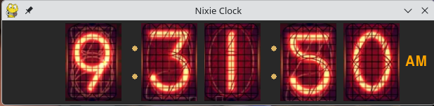

# Nixie-Tube Clock Simulator

A nostalgic desktop clock simulator featuring vintage Nixie-tube display aesthetics. Designed to bring the warm, orange glow of classic vacuum tubes directly to your desktop.



---

## Features

- **Vintage Visuals:** Authentic Nixie-tube digit styling and glow effects.
- **Cross-Platform Support:** Ready-to-run packages available for Windows, Linux, and macOS (Intel).
- **Open Source:** Written in Python (`nixie.py`) for easy customization and community contributions.

---

## Downloads (Pre-built Binaries)

You do not need to install Python to use this application! You can download pre-compiled executable zip packages for your operating system on our **[Releases](../../releases)** page:

- 🪟 **Windows**: Download `NixieWindows.zip`
- 🐧 **Linux**: Download `NixieLinux.zip` or the standalone `NixieAppImage.zip`
- 🍏 **macOS (Intel)**: Download `NixieMac.zip`
- 
My experience with the macOS version was that I had to go into the terminal and navigate to
the folder called NixieMac where my NixieMac.zip was downloaded to and run
`chmod u+x nixie.app/Contents/MacOS/nixie`
This allowed me to control-click on Nixie application and Open which shows "Apple cannot check
it for malicious software" then you click "Show in Finder" and control-click on the Nixie app
icon  where you can open the app.
  

*Note: Each release package includes its own `readme.txt` with specific help instructions.*

---

## Running from Source

If you prefer to run the app directly from the Python source code:

1. **Ensure Python 3 is installed** on your system.
2. Clone this repository:
   ```bash
   git clone https://github.com/edgargarcia1949/Nixie.git
   cd Nixie
   ```
3. Run the script:
   ```bash
   python nixie.py
   ```

---

## License

This project is open-source. Feel free to modify and distribute `nixie.py` as permitted by the repository's license.
